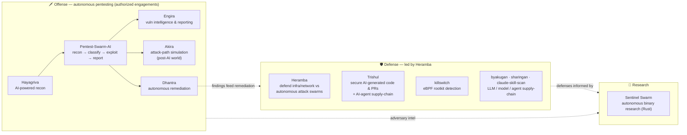

# Armur AI

### Security for the AI era — autonomous offense and defense.

*We build open-source, AI-native security infrastructure: swarms of agents that **attack** systems to find what's broken, and tools that **defend** the code, models, and AI agents everyone now ships with. We also run security engagements with the same toolchain we open-source.*

**Backed by Techstars and Outlier Ventures.**

[armur.ai](https://www.armur.ai) · [@armur_ai](https://x.com/armur_ai) · [LinkedIn](https://www.linkedin.com/company/armurai) · engagements → [akhil@armur.ai](mailto:akhil@armur.ai)

---

## The thesis

AI changed both sides of security at once. Attackers now orchestrate autonomous agents; defenders now ship code, models, and AI agents that are themselves a new attack surface. Armur builds for both ends of that shift — a **red** platform that pentests like a coordinated swarm, and a **blue** platform, led by **Heramba**, that defends infrastructure, AI-generated code, and the AI agents in your development loop.

---

## 🗡️ Offense — the autonomous pentest pipeline

For **authorized** penetration testing, bug bounty, continuous monitoring, and CTF.

- **[Pentest-Swarm-AI](https://github.com/Armur-Ai/Pentest-Swarm-AI)** — Autonomous penetration testing with a swarm of AI agents: recon, classification, exploitation, and reporting specialists coordinating through a stigmergic blackboard with ReAct reasoning. Go, Claude API, 7+ native security tools. *AGPL-3.0.*
- **[Hayagriva](https://github.com/Armur-Ai/Hayagriva)** — The recon tier for AI-powered pentesting — reconnaissance and attack-surface mapping that feeds the swarm.
- **[Engira](https://github.com/Armur-Ai/Engira)** — Vulnerability intelligence and reporting.
- **[Akira](https://github.com/Armur-Ai/Akira)** — An advanced attack-path simulator for the post-AI world.
- **[Dhantra](https://github.com/Armur-Ai/Dhantra)** — Autonomous remediation for the vulnerabilities the pentest swarm finds — closing the loop from finding to fix.
- **[agat](https://github.com/Armur-Ai/agat)** — Fingerprints polymorphic and metamorphic malware that mutates between runs; a behavioral pipeline that survives encoding, packing, and rewriting. *Featured at BSides Bangalore 2026.*

## 🛡️ Defense — led by Heramba

- **[Heramba](https://github.com/Armur-Ai/heramba)** — Protect your infrastructure and network against autonomous attack-agent swarms — defense built for an adversary that is itself a swarm.
- **[Trishul](https://github.com/Armur-Ai/Trishul)** — A local-first, open-source security scanner for AI-generated ("vibe-coded") code: SAST, SCA, secrets, and IaC, plus a flagship **AI Agent Supply-Chain Security** capability that protects developers whose AI coding agents review and check out pull requests — detecting poisoned instructions, prompt injection, unsafe install/CI hooks, untrusted MCP servers, and cross-file attack chains. Read-only, SARIF-native.
- **[killswitch](https://github.com/Armur-Ai/killswitch)** — An eBPF-based rootkit detector.
- **[byakugan](https://github.com/Armur-Ai/byakugan)** — Scan for LLM backdoors in open-weights models.
- **[sharingan](https://github.com/Armur-Ai/sharingan)** — Detect malignant LLM traces — hidden weights, smuggled inference runtimes, and self-contained agent loops.
- **[claude-skill-scan](https://github.com/Armur-Ai/claude-skill-scan)** — Scan Claude skills for vulnerabilities before you use them.

## 🔬 Research

- **[Sentinel Swarm](https://github.com/Armur-Ai/sentinel-swarm)** — A Rust-native, model-agnostic research platform coordinating heterogeneous micro-swarms of agents over a shared evidence-and-hypothesis graph, for **authorized** autonomous binary vulnerability research. Multiple research papers are planned around it.
- Our team publishes on AI security and adversarial systems — recent work includes **[XAMT: Adversarial Attacks on Multi-Agent Systems](https://arxiv.org/abs/2512.15790)** (arXiv:2512.15790).

---

## Services

We run penetration tests against web applications, cloud infrastructure, and internal networks — the same toolchain we open-source, executed by the team that built it.

For engagements: **[akhil@armur.ai](mailto:akhil@armur.ai)**

## Contact

- Web — [armur.ai](https://www.armur.ai)
- Engagements — [akhil@armur.ai](mailto:akhil@armur.ai)
- X — [@armur_ai](https://x.com/armur_ai)
- LinkedIn — [armurai](https://www.linkedin.com/company/armurai)

Everything offensive is for authorized testing only. We build to understand and defend.

